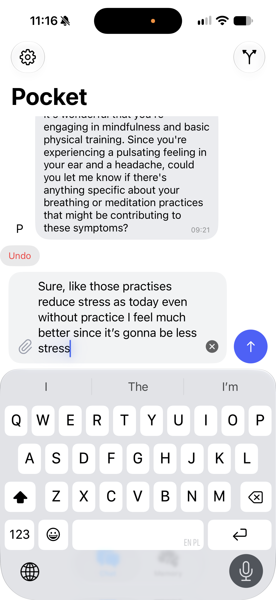
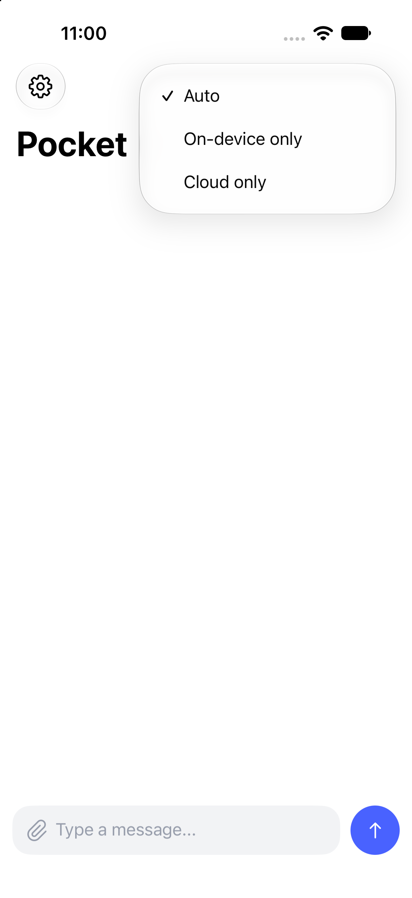
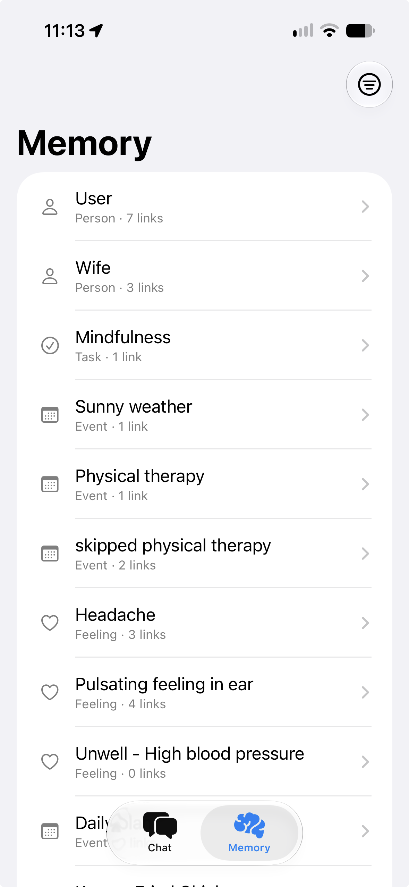
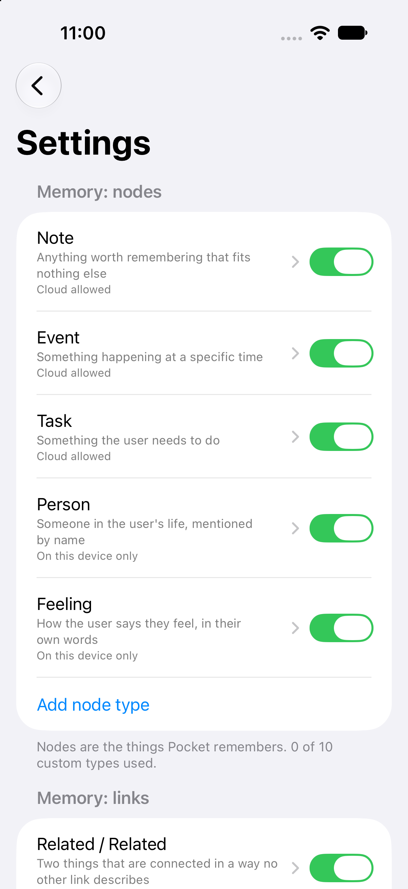
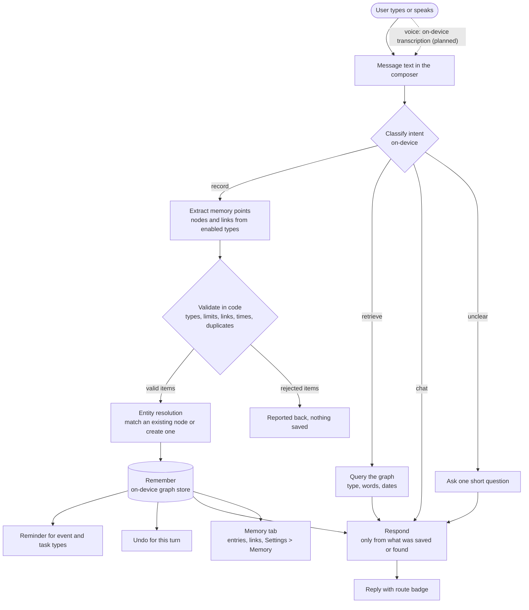

# Florque Pocket

<p align="center">
  
</p>

A chat-only iOS assistant that turns what you say or type into saved notes, events and reminders. Pocket runs its language model on the device first, and uses the cloud only when the local model cannot finish the job. It is built around one idea: a small model with a tightly managed context window can do real agentic work, if the app decides exactly what each model call gets to see.

## The idea

Most assistants send the whole conversation and the whole data store to one large model on every turn. That is slow, expensive, leaks more data than needed, and wastes context. Pocket takes the opposite approach.

- **Small local models first.** Each turn runs on Apple's on-device Foundation Model (`SystemLanguageModel`). Nothing leaves the phone unless it has to.
- **Cloud only on request.** A chat turn under `auto` stays on the device, so person and feeling content never reaches the cloud. The cloud route (Gemini through Firebase AI Logic) is used only when the developer picks cloud explicitly.
- **Small, typed model calls.** A local model has a small window (the budget code assumes about 15,000 tokens). Pocket never sends a whole chat or a whole database. Each step builds a short prompt from a typed input, and every variable part is capped before it reaches the prompt.
- **Agentic workflow with bounded loops.** A turn is a graph of small steps (classify, extract, execute, respond, clarify) with explicit repair paths. Every loop is bounded by counters in the state, and the graph has a hard step limit, so a confused model cannot run away.

## Screens

<p align="center">
  
  
  
  
</p>

## How it works



Nothing is written by the model directly. The model proposes memory points as JSON. Code validates them against the node and link types the user configured, resolves them against existing memory, and only then saves. Every write is one changeset that Undo can reverse, including its reminders.

## Context and app state management

The main engineering problem is not "call a model". It is deciding what the model needs right now, and nothing more.

**One value of state per turn.** `CERState` is a plain Swift value. Each step reads it through a gatekeeper and can change it only through its own reducer. Nothing else writes to it, so every change is traceable.

**Refusals are recorded, not silent.** A gate that refuses a step, or a reducer that refuses an outcome, appends to `rejections`. A bad step never changes the state quietly, and the log shows why a turn went the way it did.

**Each step sees only its own input.** The prompt generator uses the step's `Input` and nothing else. The classify prompt lists six intent values. The extract prompt names only the one tool the classifier chose. The respond prompt sees only the tool results for that turn.

**Budget before the call.** `TokenBudget` caps the message at 2,000 characters, keeps the last 5 chat lines (each cut to 240 characters), caps each tool result at 800 characters, and estimates tokens conservatively (2.5 characters per token, to cover Cyrillic and mixed text). The whole input must stay under a 7,000-token limit, with 1,500 tokens reserved for the system prompt.

**Saved data is a digest, not a dump.** `Digest` turns open tasks and recent notes into a compact list capped at 40 lines. It is the only saved data a model ever receives. A cloud model never sees the whole store.

**Writes are all-or-nothing.** `PocketStore` is the only access to SwiftData. Each batch saves once, and a failed save rolls the context back.

**Allow-lists match prompts.** Each step may use only the tools its prompt describes. `ToolExecutor` enforces the same list, so the prompt and the code cannot disagree.

**Saved by code, reversible.** The model never writes. Code validates each proposed node and link, then saves the valid ones in one changeset. The chat's Undo removes that changeset and its reminders. Saved items show in the Memory tab, where the user can read their links and remove a link they do not want.

## Technical implementation

### Stack

| Layer | Technology |
|---|---|
| UI | SwiftUI, one chat screen, `ChatViewModel`, built on the Exyte `Chat` package (`ChatView`, v3.3.7) |
| Agent runtime | `AgentKit` (`Florque/agent-kit`, Swift package) for graph execution (`StateGraph`, `CompiledGraph`, conditional edges, `invoke(maxSteps:)`) |
| Custom harness | In-repo: step protocol, runner, reducers, tool executor, prompt factory, budget (below) |
| On-device model | Apple Foundation Models (`FoundationModels`, `LanguageModelSession`), used directly or through Firebase AI Logic |
| Cloud model | Gemini (`gemini-2.5-flash-lite`) through Firebase AI Logic (`FirebaseAI`); Private Cloud Compute when built with `POCKET_PCC` |
| Storage | SwiftData (`@ModelActor PocketStore`), file-backed; in-memory for tests |
| Reminders | EventKit, behind the `RemindersAdapter` protocol |
| Backend and security | Firebase Core, Firebase App Check (debug provider in DEBUG builds) |

### Seams

Two protocols keep the core testable and the backends swappable:

- `ModelAdapter`: `generate(system:user:policy:) -> ModelReply`. Implemented by `FoundationModelsAdapter` (the `apple` backend) and `FirebaseModelAdapter` (the `firebase` backend). Each adapter decides how to serve a `RoutePolicy`: `forceOnDevice`, `forceCloud`, or `auto`.
- `RemindersAdapter`: creates a reminder and returns its identifier. Implemented by `EventKitReminders`.

Tests substitute scripted fakes for both, so no test needs a network, a model or EventKit.

### Workflows

`TurnWorkflow` is the seam between the `Assistant` and one turn. `WorkflowFactory` builds a workflow from a `WorkflowID`:

- `cer`: classify, extract, execute, respond, with clarify. The only workflow the app ships with.

`Assistant` owns the entry point and undo of a turn's changeset. `ChatViewModel` fixes the backend and workflow when it is built. The chat screen is Exyte's `ChatView` from the `Chat` package (`github.com/exyte/Chat`), which renders the message list and composer; `ChatScreen` passes it the view model's messages and a send handler.

### The custom harness: steps

Every `cer` step conforms to `CERStepKind` and runs five stages in fixed order. `CERStepRunner` executes them and logs each one:

1. **gate**: checks the state and returns a typed `Input`, or refuses. A refused gate stops the step before any model call.
2. **prompt**: builds the prompt from `Input` only.
3. **process**: the only impure stage. A model call, or a deterministic flow (tools).
4. **parse**: extracts the expected values from the reply. JSON is found by position, so prose around it is ignored.
5. **reduce**: the only code that changes the state, for this step's fields.

`CERStep` values are the graph node names. Steps are small structs: `ClassifyStep`, `ExtractStep` (also used for repair), `ExecuteStep`, `RespondStep` (also used for repair), `ClarifyStep`.

### Tools

Two tools, both over the memory graph in `PocketStore`:

| Tool | Kind | Step |
|---|---|---|
| `record` | write: nodes and links, with an EventKit reminder for types that schedule one | extract, then execute |
| `retrieve` | read: keyword, type and date range, plus one hop of links | extract, then execute |

The classifier picks the tool by name (`CERIntent`). The extract step fills only that tool's arguments. A missing required argument, such as the time of an event, goes into `missing`, and the workflow asks the user. It is not an error. `execute` is deterministic: it runs the calls in order. A retrieve with no hits and a text query runs once more without the query.

### CER graph

```
classify ─ unclear / failed twice ─→ clarify
         ─ failed once ───────────→ classifyRepair ─→ extract (or clarify)
         ─ chat ──────────────────→ respond
         ─ record / retrieve ─────→ extract

extract  ─ missing details ───────→ clarify
         ─ failed once ───────────→ extractRepair ─→ execute (or clarify)
         ─ ok ────────────────────→ execute

execute  ─ tool error ────────────→ clarify
         ─ ok ────────────────────→ respond

respond  ─ empty reply ───────────→ respondRepair ─→ end
         ─ reply ─────────────────→ end

clarify  ─────────────────────────→ end
```

Each loop is bounded by `classifyAttempts`, `extractAttempts` and `respondAttempts` in the state. `invoke(maxSteps: 12)` bounds the whole graph. `CERWorkflow.makeGraph` builds it, and `afterClassify` and `afterExtract` choose the edges by reading the state the reducers wrote.

**Every CER call stays on the device under `auto`.** `CERTurnValues` maps `auto` to `forceOnDevice` for each step, including repairs. Only an explicit cloud choice in the chat's route menu sends a turn to the cloud.

### Prompts

`CERPrompts` holds one short system prompt per step, plus the repair prompts. Each one names its JSON reply shape. The node and link types the user enabled in Settings > Memory are added to the extract prompt as short "when to use" lines, capped by `GraphPromptBlocks`.

### Logging and debugging

`Log.debug` prints one line per stage in DEBUG builds only, in the form `[cer] step stage: note`. Release builds print nothing. Every stage is also kept in `CERState.log`, so tests can check the exact order of stages.

Debug launch arguments let you pick the backend, workflow and policy from the command line:

```
-backend apple|firebase   -workflow cer   -policy auto|forceOnDevice|forceCloud   -autoSend "text"
```

## Testing

- `CERTests`: each step's gate, prompt, process, parse and reduce stages on their own, the runner contract, the on-device routing guard, and whole turns against a scripted model.
- `AssistantTests`: the test fakes (`FakeModel`, `FakeReminders`) and the in-memory store helper.
- `GraphValidatorTests`, `GraphStoreTests`, `GraphQueriesTests`, `GraphPromptBlocksTests`, `GraphSeedTests`: the memory graph rules, apply and undo, queries, prompt blocks and the default types.
- `MemoryModelTests`, `PocketStoreTests`: the Memory tab's filtering and search, and the store.
- UI tests: launch tests in `florque-pocketUITests`.

## Project layout

```
florque-pocket/                     repository root
├── florque-pocket.xcodeproj        Xcode project, Swift packages resolved here
├── florque-pocket/                 app sources
│   ├── florque_pocketApp.swift     entry point, Firebase setup, DEBUG test hooks
│   ├── Core/
│   │   ├── Assistant/              Assistant, workflow seam, budget, adapters
│   │   │   └── Workflows/CER/      the cer workflow: graph, state, steps, tools, prompts
│   │   ├── Graph/                  memory graph: types, nodes, links, validator, store, queries
│   │   ├── Store/                  PocketStore (SwiftData), models
│   │   └── Logging/                Log
│   ├── Adapters/                   FoundationModels, Firebase AI, EventKit
│   └── UI/                         ChatScreen, ChatViewModel, Memory/ (tab), Settings/ (types)
├── florque-pocketTests/            unit and eval tests
└── florque-pocketUITests/          UI tests
```

## Build and run

1. Open `florque-pocket.xcodeproj` in Xcode. Swift packages resolve automatically (AgentKit, Firebase, Chat, and others).
2. Add the Firebase configuration file (`GoogleService-Info.plist`) for your project, and register the App Check debug token in the Firebase console.
3. Run on an iOS device or simulator with Apple Intelligence enabled for the on-device route. The `firebase` backend and the cloud route need network access and a Firebase project with AI Logic enabled.

To build with Private Cloud Compute, set `POCKET_PCC` in the build settings, with an SDK that provides `PrivateCloudComputeLanguageModel`. Without it, cloud calls on the Apple backend fail with a clear message.

## Status

The `cer` workflow is the only workflow; the earlier `intent` workflow was removed. Scope and open work are tracked in `docs/pocket-scope-v2.md` and `docs/pocket-engineering-plan.md`.
